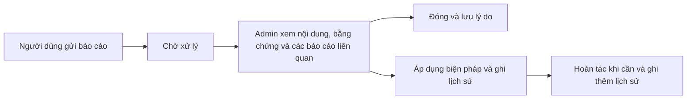

# Kế hoạch thiết kế module Báo cáo vi phạm

Phương án A được chốt ngày 14/11/2026. Phần hiện trạng ghi theo thời điểm khảo sát. Hợp đồng triển khai và bước cấu hình nằm trong [đặc tả mục 30](BACKEND_API_SPECIFICATION.md#30-báo-cáo-vi-phạm-reports) và ADR-056.

## Triển khai trên môi trường đích

1. Chạy `liquibase:diff` theo quy trình của repo, kiểm tra và áp dụng changeset sinh từ entity trước khi khởi động BE. Đối chiếu bảng `moderation_actions` và sequence, cột `reports.outcome/snapshot/private_evidence_key`, `posts.moderation_action_id`, `comments.moderation_action_id`, `users.suspended_until/moderation_action_id/session_epoch` và `notifications.body` dài 640 ký tự. Cột mới trên bảng cũ cho phép null để đọc dữ liệu hiện có. Cả ba cột `moderation_action_id` cần khóa ngoại trỏ tới `moderation_actions.id`.
2. Tạo bucket riêng tư `R2_REPORT_EVIDENCE_BUCKET`, tắt public access, cấp token quyền đọc/ghi/xóa và giữ bucket này khác bucket media. Cấu hình `REPORT_EVIDENCE_RETENTION_DAYS` nếu cần đổi mặc định 90 ngày kể từ khi duyệt. Thời hạn ký đọc là 120 giây. Đơn chưa duyệt giữ ảnh và bản chụp để Admin xử lý.
3. Kiểm kê báo cáo và ảnh cũ trên môi trường đích. Admin có thể sao chép ảnh cũ thuộc URL SQB hợp lệ sang kho riêng trong chi tiết. Trước khi xóa đối tượng từ kho public, kiểm tra các tham chiếu hiện có. Sau khi cập nhật schema và cấu hình kho, triển khai BE rồi FE.
4. Nghiệm thu hai tài khoản gửi và duyệt trên môi trường đích với ảnh thật, hai Admin xử lý đồng thời, tìm kiếm sau khi ẩn/khôi phục và phiên người dùng đang kết nối khi bị đình chỉ. Khi số đơn tăng, cân nhắc index `(status, id)`, `(target_type, target_id, id)` và `(reporter_id, created_at)` để hỗ trợ phân trang, truy vấn cùng đối tượng và giới hạn gửi. Kiểm tra bằng `EXPLAIN` trước khi thêm index.

## 1. Hiện trạng trong mã nguồn

| Hạng mục | Đã có | Cần bổ sung |
| --- | --- | --- |
| Gửi báo cáo | `POST /api/v1/report` nhận `POST`, `COMMENT`, `USER` và lưu `PENDING` vào `reports`. `Report` đã có `@Version`, người gửi, người duyệt, thời điểm duyệt và ghi chú kết quả. | Kiểm tra quyền xem đối tượng, báo cáo trùng và bằng chứng. Kiểm tra hiện tại chủ yếu dựa vào sự tồn tại của ID và chặn tự báo cáo tài khoản. |
| Điểm vào FE | `ReportModal` hỗ trợ ba loại qua `targetType`. Điểm vào đang dùng là `PostFeedCard` trên Bảng tin, chi tiết bài và tab Video học tập. | Gắn menu cho bình luận, phản hồi và hồ sơ người khác. |
| Quản trị | `/admin/reports` có route dành cho Admin và hiển thị thông báo chờ chức năng như ảnh tham chiếu. | API danh sách, chi tiết, quyết định và hoàn tác. |
| Biện pháp hiện có | Chủ nội dung hoặc Admin có thể gọi API xóa bài và bình luận. Tác vụ xóa tài khoản theo yêu cầu có sẵn. | Luồng kiểm duyệt riêng có lý do và lịch sử. Xóa bài/bình luận hiện ghi đè nội dung và dọn media. Xóa tài khoản theo yêu cầu ẩn danh dữ liệu. |

Mục 30.1 của `BACKEND_API_SPECIFICATION.md` nhắc đến tin nhắn và câu hỏi. `ReportTargetType` thực tế chỉ có ba loại trên. Nút **Báo lỗi** trong Luyện tập dùng `PUT /api/v1/questions/{questionId}/report` và quy trình báo lỗi học thuật riêng. Báo cáo tin nhắn riêng có thể xét ở đợt sau, cùng chính sách chọn ngữ cảnh tin nhắn và quyền xem bằng chứng.

## 2. Quy trình đề xuất cho bản đầu

- Mỗi lần gửi hợp lệ tạo một đơn. Mỗi người có tối đa một đơn `PENDING` trên cùng cặp loại và ID đối tượng. Gửi lại trong lúc chờ trả về thông tin đơn đã có. Giới hạn tần suất cho đơn mới theo tài khoản. Người khác vẫn có thể báo cáo cùng đối tượng.
- Hàng đợi mở một dòng cho mỗi đơn. Chi tiết hiển thị các đơn cùng đối tượng và trạng thái biện pháp hiện tại. Mỗi đơn có trạng thái `PENDING` hoặc `RESOLVED`. Kết quả lưu riêng, ví dụ `DISMISSED`, `TARGET_UNAVAILABLE`, `ALREADY_MODERATED` hoặc `ACTION_TAKEN`.
- Admin xem trạng thái đối tượng hiện tại và bản chụp tối thiểu tại thời điểm gửi, gồm phần văn bản cần xem xét, ID tác giả nếu có và mốc sửa nếu đối tượng hỗ trợ. Báo cáo cũ có thể thiếu bản chụp. Nếu đối tượng đã bị xóa hoặc ẩn danh, chi tiết vẫn mở và Admin có thể đóng đơn với lý do phù hợp. Áp dụng thời hạn lưu và giới hạn phạm vi bản chụp theo chính sách đã chốt.
- Mọi quyết định yêu cầu lý do. Nội dung gửi cho người dùng dùng thông điệp riêng, có thể tái sử dụng `NotificationWriter` cho người gửi và tác giả còn truy cập được. Thông báo cho người gửi xác nhận đã xử lý. Thông báo cho tác giả nêu biện pháp, lý do và thời hạn nếu có. Tài khoản bị đình chỉ nhận thông báo thời hạn/lý do phù hợp khi đăng nhập, sau khi đã xác thực thông tin đăng nhập. Danh tính và bằng chứng của người gửi chỉ hiện trong khu vực Admin.

### Biện pháp theo đối tượng

| Đối tượng | Biện pháp đề xuất | Hiệu lực và hoàn tác |
| --- | --- | --- |
| Bài viết, gồm video học tập | Ẩn do kiểm duyệt | Lưu dấu ẩn riêng trên bài. Áp dụng ở Bảng tin, hồ sơ, video, tìm kiếm, truy cập trực tiếp và API tương tác liên quan. Giữ nội dung và media để khôi phục theo quyền xem hiện tại nếu bài còn tồn tại. |
| Bình luận, gồm phản hồi | Ẩn do kiểm duyệt | Hiện nhãn thay nội dung, giữ cấu trúc luồng trả lời và chặn tương tác trực tiếp với bình luận bị ẩn. Điều chỉnh bộ đếm đúng một lần mỗi lần ẩn hoặc khôi phục. |
| Tài khoản | Cảnh cáo hoặc đình chỉ có thời hạn | Cảnh cáo tạo lịch sử và thông báo. Đình chỉ dùng mốc hết hạn độc lập với trạng thái xóa tài khoản. Chặn đăng nhập, refresh, REST và STOMP trong thời hạn. Thu hồi phiên để cần đăng nhập lại sau khi hết hạn hoặc được gỡ. Bài cũ được xét riêng bằng báo cáo nội dung. |

Đề xuất quyền `ADMIN` cho toàn bộ quy trình. Đơn về tài khoản Admin vẫn được tiếp nhận và lưu quyết định. Biện pháp đình chỉ tài khoản Admin cần quy tắc phê duyệt riêng. Đợt đầu xử lý thủ công từng đơn. Số lượng báo cáo giúp Admin xem bối cảnh, và Admin quyết định biện pháp sau khi đọc bằng chứng.

## 3. Hợp đồng API đề xuất

Các đường dẫn dưới đây tính từ `/api/v1`. Dùng `GlobalResponse`, `snake_case` trên HTTP và quy ước con trỏ `after`, `limit`, `pagination.has_next` của SQB.

| Method và đường dẫn | Quyền | Dữ liệu và hành vi chính |
| --- | --- | --- |
| `POST /report` | Người đã đăng nhập | Giữ payload và DTO phản hồi cho client cũ. Trả `201` khi tạo, `200` kèm cùng ID khi đơn đang chờ đã tồn tại. Thêm `evidence_keys` cho client mới khi hỗ trợ kho riêng tư. |
| `GET /admin/reports` | Admin | Lọc `status`, `target_type`, `violation_type`. Mặc định `PENDING`, sắp `id DESC`, phân trang `after` và `limit`. Trả bản tóm tắt, số đơn đang chờ cùng đối tượng và thông tin đối tượng còn sẵn. |
| `GET /admin/reports/{id}` | Admin | Trả đơn, `version`, bản chụp, trạng thái hiện tại, bản xem trước bằng chứng, các biện pháp và khả năng thực hiện. |
| `GET /admin/reports/{id}/related` | Admin | Trả danh sách đơn cùng đối tượng theo con trỏ, tải khi mở mục liên quan. |
| `POST /admin/reports/{id}/resolve` | Admin | Nhận `version`, `action`, `reason` và `suspended_until` khi đình chỉ. Các hành động gồm đóng đơn, ẩn nội dung, cảnh cáo hoặc đình chỉ theo loại đối tượng. Trả `409` khi trạng thái đã đổi hoặc Admin khác đã xử lý. |
| `POST /admin/moderation-actions/{id}/reverse` | Admin | Nhận `reason`. Khôi phục nội dung hoặc gỡ đình chỉ nếu biện pháp gốc còn hiệu lực và đối tượng đủ điều kiện. Ghi một hành động tham chiếu biện pháp gốc. |

API tạo báo cáo lấy danh tính người gửi từ phiên đăng nhập. Tái sử dụng quy tắc xem bài, hồ sơ, bài giảng và luồng cha của bình luận. Đối tượng thiếu hoặc người gửi không có quyền xem có thể cùng trả `404` để tránh lộ thông tin. API Admin kiểm tra quyền và điều kiện thực thi trong service. FE làm mới chi tiết khi gặp `409` và giữ lý do Admin đã nhập.

## 4. Dữ liệu, giao dịch và bằng chứng

- **Dữ liệu**. Tái sử dụng `Report`, gồm `reviewer`, `reviewedAt`, `resolutionNote` và `version`. Đề xuất bổ sung kết quả, bản chụp có thể rỗng và bảng `moderation_actions` ghi đối tượng, đơn nguồn, Admin, hành động, lý do, thời điểm, thời hạn và liên kết hành động bị hoàn tác. Dấu ẩn trên nội dung và mốc đình chỉ trên tài khoản phản ánh hiệu lực hiện tại. Cột mới cần tương thích bản ghi cũ. Rà dữ liệu cũ trước khi thêm ràng buộc chống trùng.
- **Tính nhất quán**. Khóa đối tượng và đơn theo thứ tự nhất quán, kiểm tra `version` và hiệu lực hiện tại rồi lưu quyết định, thay đổi đối tượng và lịch sử trong một giao dịch. Hai đơn khác nhau trên cùng đối tượng phải cùng kiểm tra trạng thái biện pháp. Khôi phục kiểm tra đúng biện pháp đang hiệu lực để tránh hoàn tác nhầm. Đưa đồng bộ tìm kiếm, ngắt STOMP và phát thông báo ra sau commit, có cách thử lại an toàn cho việc đồng bộ thất bại. Các đường đọc kiểm tra trạng thái DB để dữ liệu tìm kiếm hoặc cache cũ không làm lộ nội dung đã ẩn.
- **Tài khoản**. Kiểm tra thời hạn đình chỉ ở đăng nhập, refresh, xác thực REST và STOMP. Tái sử dụng hạ tầng thiết bị và `AccountWebSocketSessions` để thu hồi phiên, ngắt kết nối đang mở và xử lý tình huống STOMP kết nối cùng lúc với đình chỉ. Chặn xác thực trong thời hạn dù việc ngắt socket gặp lỗi. Khi hết hạn hoặc gỡ đình chỉ, người dùng đăng nhập lại và trạng thái xóa tài khoản tiếp tục được áp dụng độc lập.
- **Bằng chứng**. Form hiện tải một ảnh mục đích `POST` và gửi URL public. Đề xuất mục đích upload riêng, xác thực quyền sở hữu key, mục đích, kích thước, định dạng và sự tồn tại của ảnh. Trong giai đoạn tương thích, URL đầu vào chỉ được chuyển thành key với nguồn kho SQB và có bằng chứng sở hữu hợp lệ. Gọi `mediaService.confirmMediaPermanent` khi gắn ảnh vào đơn và đưa ảnh về hàng tạm nếu giao dịch rollback. Bằng chứng mới dùng kho riêng tư và URL đọc ký ngắn hạn do API Admin cấp. Kiểm kê URL cũ trước khi chuyển kho và xác định thời hạn lưu, dọn ảnh và quyền truy cập. Việc ẩn trên ứng dụng kiểm soát các màn và API của SQB. Link media public đã phát hành cần được đánh giá riêng nếu chính sách yêu cầu thu hồi truy cập trực tiếp.
- **Truy vấn**. Quan hệ `@ManyToOne` và `@OneToOne` dùng `LAZY`. Join fetch quan hệ đơn cần thiết và truy vấn `IN` theo lô theo từng loại đối tượng của trang. Tính số đơn liên quan bằng truy vấn nhóm. Đề xuất index `(status, id)` cho hàng đợi mặc định, `(target_type, target_id, id)` cho lịch sử theo đối tượng và unique có điều kiện cho đơn `PENDING` theo người gửi/đối tượng để chống hai request đồng thời. Xác nhận nhu cầu index theo dữ liệu và kế hoạch truy vấn. Sau khi chốt và cập nhật entity, người dùng chạy `liquibase:diff` hoặc tạo changeset tương ứng.

## 5. Giao diện và thứ tự triển khai

1. **Nền tảng tiếp nhận**. Kiểm kê đơn cũ và ảnh cũ. Chốt quyền truy cập, kết quả duyệt, bản chụp và thời hạn lưu. Giữ `POST /report` tương thích trong lúc chuyển FE. Thêm API danh sách và chi tiết Admin, triển khai schema theo quy trình của repo và cập nhật đặc tả API.
2. **Hàng đợi Admin và điểm vào gửi**. Dùng `AdminPageHeader` và token SQB hiện có. Desktop hiển thị bảng gồm đối tượng, lý do, thời điểm, trạng thái. Mobile dùng thẻ và mở chi tiết riêng. Giữ bộ lọc khi quay lại từ chi tiết. Gắn `ReportModal` vào bài, bình luận và phản hồi trong các màn đang dùng, gồm thảo luận câu hỏi nếu bình luận đủ quyền xem, và menu hồ sơ cạnh thao tác Chặn. Trong `features/report`, triển khai types/service, TanStack Query, component rồi route. Có skeleton, trạng thái rỗng, lỗi/thử lại và dữ liệu thành công. Điều hướng bàn phím có focus rõ, trạng thái có nhãn chữ.
3. **Quyết định và ẩn nội dung**. Nối đóng đơn, ẩn và khôi phục. Chi tiết hiển thị bản chụp, ảnh bằng chứng, trạng thái hiện tại, đơn liên quan và lịch sử. Xác nhận trước biện pháp có tác động và hiện rõ nội dung nào sẽ bị ẩn. Phát hành sau khi rà đủ các đường đọc và bộ đếm. Chỉ công bố khả năng gửi cho cả ba loại khi Admin đã có hàng đợi để tiếp nhận.
4. **Cảnh cáo và đình chỉ**. Thêm biện pháp tài khoản sau khi chốt thời hạn, vai trò được xử lý và cách thông báo. Nghiệm thu refresh, phiên đang mở, tự hết hạn và gỡ sớm trước khi bật hành động trên UI. Cân nhắc gom hồ sơ theo đối tượng sau khi có số liệu hàng đợi thực tế.

### Ca nghiệm thu trọng tâm

- Gửi được từ bài thường, video, bình luận/phản hồi và hồ sơ. Gửi trùng đồng thời tạo một đơn, hai người báo cùng mục tiêu vẫn có hai đơn. Kiểm tra quyền xem của người gửi và quyền Admin của từng API.
- Đơn cũ, bài đã sửa, đối tượng đã xóa và ảnh lỗi vẫn có chi tiết xử lý được. Phân trang theo bộ lọc ổn định, kiểm tra số truy vấn theo từng loại đối tượng trong trang.
- Hai Admin cùng thao tác trên một đơn hoặc hai đơn cùng đối tượng. Chỉ có một thay đổi hiệu lực tương ứng. Lỗi giao dịch giữ đối tượng và đơn ở trạng thái trước đó.
- Sau khi ẩn, bài/bình luận được lọc ở các API liên quan và hiển thị đúng khi khôi phục. Bộ đếm, luồng trả lời và tìm kiếm nhất quán. Kiểm tra cả bài giảng hạn chế theo môn.
- Đình chỉ có hiệu lực với thiết bị và STOMP đang mở. Token cũ bị thu hồi, hết hạn và gỡ sớm cho phép đăng nhập mới. Kiểm tra trên PostgreSQL, Redis, R2 và trình duyệt với tài khoản thực nghiệm thu.

## 6. Các lựa chọn cần chốt

| Quyết định | Phương án A đề xuất | Phương án B |
| --- | --- | --- |
| Đơn vị hàng đợi | Mỗi đơn một dòng, có nhóm liên quan trong chi tiết. Tận dụng dữ liệu hiện có và giữ lý do riêng từng đơn. Admin có thể phải đóng thêm các đơn cùng mục tiêu. | Mỗi đối tượng một hồ sơ, quyết định trên hồ sơ. Giảm việc lặp, cần quy tắc gom các lý do khác nhau, chốt kết quả từng người gửi và mở hồ sơ mới khi tái phạm. |
| Xử lý tài khoản | Cảnh cáo và đình chỉ có thời hạn. Đề xuất các mốc 24 giờ, 7 ngày, 30 ngày và khả năng gỡ sớm. Phù hợp vi phạm lặp lại và cần thay đổi xác thực/phiên. | Cảnh cáo trong đợt đầu. Có thể phát hành nhanh hơn, Admin chỉ áp dụng được ẩn nội dung và cảnh cáo cho trường hợp tái phạm. |
| Bằng chứng | Dùng kho riêng tư ngay khi mở rộng báo cáo và chốt thời hạn lưu. Admin xem được ảnh nhạy cảm với quyền kiểm soát. Cần cấu hình R2 và xử lý URL cũ. | Phát hành tiếp nhận và duyệt theo mô tả/bản chụp, chuyển phần tải ảnh sang đợt sau. Có thể phát hành hàng đợi sớm hơn, người gửi cần mô tả bằng văn bản trong giai đoạn chuyển tiếp. |
